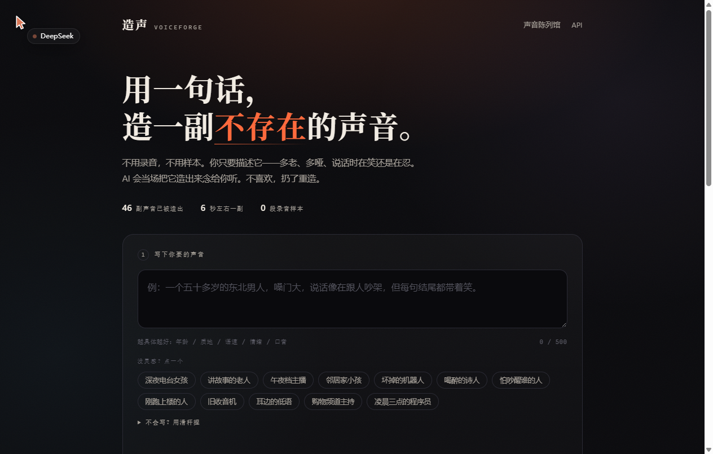
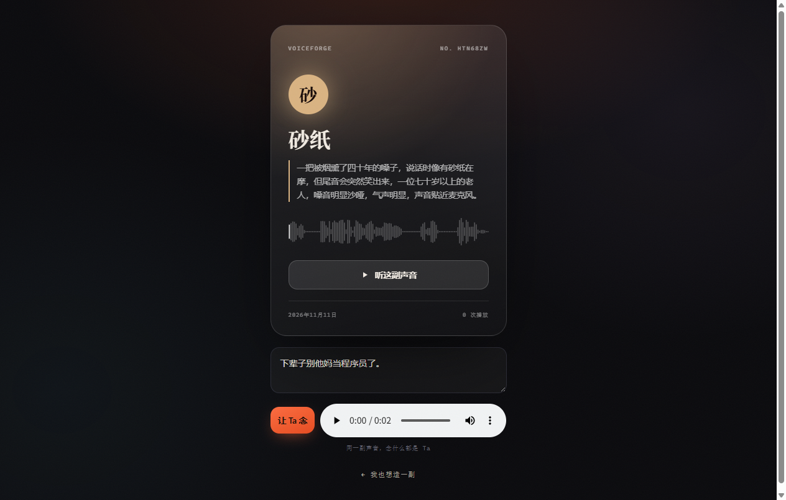

# 造声 Voiceforge — 用一句话，造一副不存在的声音

> 写一句描述 → AI 当场造出一个音色念给你听 → 不满意就重抽 → 喜欢就锁成一张**声音卡**。
> 卡片有名字、有配色、有波形、有二维码。别人扫开，能让这副声音念**他自己**想听的话。

不需要录音，不需要样本。0 段音频输入。

**在线试试：** https://just-simulations-elderly-mild.trycloudflare.com
**仓库地址：** https://github.com/hgyguyg/voiceforge
（Cloudflare 免费隧道，进程一停就换域名。打不开就本地跑，见下面「30 秒上手」。）



---

## 它解决的是什么问题

一切「让 AI 说话」的产品都卡在同一个地方：**声音从哪来**。

- 真人录音：要找人、要设备、要授权，一个人只有一副嗓子。
- 传统声音克隆（GPT-SoVITS 之类）：至少 5 秒到 1 分钟的目标音频样本，还得先有这个人。
- 那如果我要的声音根本不存在呢？一个「七十岁、抽了四十年烟、说话像在跟人吵架、但每句结尾都在笑」的人——上哪儿录去？

阿里云百炼的 **CosyVoice 声音设计（voice design）** 把这件事反过来了：不用给样本，给一句**文字描述**，它直接合成一个符合描述的、此前不存在的音色，并返回一个可长期复用的 `voice_id`。

但 API 是 API，不是产品。这个仓库把它做成了一个能玩、能传的东西：**声音卡**。

---

## 30 秒上手

```bash
git clone https://github.com/hgyguyg/voiceforge.git && cd voiceforge
pip install -r requirements.txt
export DASHSCOPE_API_KEY=sk-xxxxxxxx      # Windows: set DASHSCOPE_API_KEY=...
python run.py
```

打开 http://127.0.0.1:8000 就能造了。

> Windows 上如果 Key 是刚在「系统属性 → 环境变量」里设的，当前终端可能读不到。
> 本项目的 `app/dashscope_client.py` 会自动回退去注册表读一次（`[Environment]::GetEnvironmentVariable('DASHSCOPE_API_KEY','User')`），所以不用重开终端。

想从公网访问（手机扫码看卡片必须）：

```bash
# 任选其一
cloudflared tunnel --url http://127.0.0.1:8000     # 免费，给一个 https://xxx.trycloudflare.com
ngrok http 8000
```

Windows 上打包好的双击启动脚本见 `start.bat`。

### 声音陈列馆里那 46 副是什么

首页底部的「声音陈列馆」里现有 **46 张真实生成的声音卡**，全部来自 `tools/seed_gallery.py`：

```bash
python tools/seed_gallery.py        # 46 条人工写的描述 → 并发造声 → 直接成卡
```

它跑的是同一套 `design_voice()` + `create_card()`，不是假数据。所以第一次打开首页时，你不会看到一座空馆子。
（脚本放在 `tools/` 里，因为它是可复现的证据：那 46 副声音不是贴的循环音频。）

---

## 玩法

### ① 写描述

一句话说清「多老 / 多哑 / 语速 / 情绪 / 口音」，越物理越好。

```
一个五十多岁的东北男人，嗓门大，说话像在跟人吵架，但每句结尾都带着笑。
```

首页给了 12 个灵感标签（深夜电台女孩、讲故事的老人、坏掉的机器人、喝醉的诗人、旧收音机…），点一下就填进描述框。

### ② 或者拉滑杆

不想写字就拉滑杆：年龄 / 沙哑度 / 语速 / 情绪 / 音量 / 气声。**只有你动过的那几根**会被翻译成文字拼进描述，没动过的不算数——不然每副声音都会带上「三十岁、嗓音干净」。

### ③ 听，然后重抽

**同一个描述每次造出来都不一样。** 这不是 bug，是这个产品的核心玩法（实测：同一句描述连造 3 次）：

| 同一句描述造 3 次 | voice_id 尾段 | 试听音频 md5 | 耗时 |
|---|---|---|---|
| 第 1 次 | `...tri0-596efce4` | `b8452c18…` | 8.9s |
| 第 2 次 | `...tri1-c73663d7` | `b73e7685…` | 8.0s |
| 第 3 次 | `...tri2-df547361` | `ea7c7c06…` | 8.1s |

**但同一个 `voice_id` 合成是稳定的**（同一句话连念 3 次，md5 完全一致 `f4f2952f…`，字节数都是 172844）。所以「抽到满意的 → 存下 voice_id → 以后一直用它」这条路是通的，成卡逻辑就是这么做的。

所以界面上有个「换一副」按钮，和一行「第 N 次抽」。抽卡的手感是产品的一半。

### ④ 锁定成卡

选一个颜色，起个名，得到一张竖版卡片：编号、名字、描述原文、真实波形、播放按钮、二维码。

### ⑤ 卡片页：让别人用 Ta 说话

打开 `/c/<id>`，任何人都能让这副声音念**他自己**输入的文字（≤300 字）。这是它区别于「音色试听 demo」的地方——声音有了归属，也有了社交属性。



---

## 技术栈

**FastAPI + 原生 HTML/CSS/JS，零构建、零框架、零 npm。**

```
voiceforge/
├── app/
│   ├── main.py              # 路由：design / cards / say / play / qr / gallery
│   ├── dashscope_client.py  # 百炼客户端：音色设计 + 语音合成 + 取 Key
│   ├── store.py             # SQLite：cards / drafts 两张表
│   └── static/
│       ├── index.html       # 主页（五区块）
│       ├── card.html        # 卡片页
│       ├── css/{base,forge,card}.css
│       └── js/{app,card}.js # 波形用 decodeAudioData 真实算 peaks
├── run.py
└── requirements.txt
```

关键设计取舍：

- **SQLite 而不是 Postgres**：单机单进程够用，`data/voiceforge.db` + `data/audio/*.wav` 拷走就是完整备份。
- **草稿 / 卡片分离**：`/api/design` 只落草稿（`drafts` 表），点「就它了」才把音频**复制**一份成 `card_<id>.wav`。草稿可以随时清理，卡片不会失效。
- **波形是真波形**：前端 `fetch` 音频 → `AudioContext.decodeAudioData` → 按块取绝对峰值 → Canvas 画 96 根柱子。不是随机数，也不是静态图。
- **零构建**：没有 npm、没有打包、没有 node_modules。改一行 CSS 刷新就见效。这是为了「3 天做完」做的取舍。

---

## API

| 方法 | 路径 | 说明 |
|---|---|---|
| `POST` | `/api/design` | `{prompt, preview_text?}` → `{draft_id, voice_id, audio_url, elapsed_ms}` |
| `POST` | `/api/cards` | `{draft_id, name, accent}` → `{card_id, url}` |
| `GET` | `/api/cards/{id}` | 卡片详情 |
| `POST` | `/api/cards/{id}/say` | `{text}` → `{audio_url}`，用这副声音念任意文字 |
| `POST` | `/api/cards/{id}/play` | 播放计数 +1 |
| `GET` | `/api/gallery` | 声音陈列馆（最近 24 张） |
| `GET` | `/api/qr?d=<url>` | 把链接画成二维码 PNG |
| `GET` | `/api/health` | `{ok, cards, model}` |

交互式文档：`/api/docs`。

### 底层用的是百炼哪两个接口

```python
# 造音色
POST https://dashscope.aliyuncs.com/api/v1/services/audio/tts/customization
{
  "model": "voice-enrollment",
  "input": {
    "action": "create_voice",
    "target_model": "cosyvoice-v3.5-plus",
    "voice_prompt": "一个五十多岁的东北男人，嗓门大……",
    "preview_text": "你好，我是刚刚被造出来的声音。",
    "prefix": "vf1731...",
    "language_hints": ["zh"]
  },
  "parameters": {"sample_rate": 24000, "response_format": "wav"}
}

# 用这个音色说话
POST https://dashscope.aliyuncs.com/api/v1/services/audio/tts/SpeechSynthesizer
{
  "model": "cosyvoice-v3.5-plus",
  "input": {"text": "夜里三点，收音机自己开了。", "voice": "<voice_id>",
            "format": "wav", "sample_rate": 24000}
}
```

⚠️ 合成接口返回的 `output.audio.url` 是**带签名的 OSS 链接**，要再 GET 一次才能拿到音频字节。

---

## 踩过的坑（都写在代码注释里了）

1. **端点对不上，报 `url error, please check url！`**
   查了一晚上。这个报错在阿里云文档里的官方解释是「模型名称与 API 端点不匹配」。语音合成必须走 `/audio/tts/SpeechSynthesizer`，不是 `/aigc/multimodal-generation/generation`（那个是多模态通义万相/千问 VL 用的）。

2. **新域名 DNS 解析不了**
   文档写的是 `https://{WorkspaceId}.cn-beijing.maas.aliyuncs.com/...`，本机 `getaddrinfo failed`。改用旧域名 `dashscope.aliyuncs.com` 一切正常。

3. **Windows 当前进程读不到新设的环境变量**
   环境变量写进注册表了，但已启动的 shell 是旧快照。程序里做了注册表兜底。

4. **`preview_text` 有 15–200 字符的下限**
   传短了直接 400。`_clean_preview()` 会自动补足。

5. **画布在隐藏面板里算出来是 0×0**
   面板还没 `display` 时 `clientWidth === 0`，`cv.width = 0`，之后波形永远画不出来。修法是 `if (!W || !H) return;` + 面板显示后主动重绘一次。

---

## 边界与已知限制（说清楚，不装）

- **音色漂移**：`voice_id` 是固定映射，同一个 id 长期复用不会变声；但**换措辞就是换嗓子**——描述差一个字，造出来的是另一副声音。想要稳定的角色音，正确做法是先抽到满意的，然后把 `voice_id` 存下来一直用（本项目成卡时就是这么做的）。
- **延迟**：造音色平均 **6–9 秒**（服务端现造音色 + 返回 wav），合成平均 **1.5 秒**。不是流式，做不到秒回。
- **描述与结果的相似度，我没法客观验证。** 我听不到音频，只能从接口层面确认「同一描述造 3 次 → 3 个不同 `voice_id` → 3 段 md5 不同的音频」。至于造出来像不像那句描述，需要人耳判断——这一条是留给你的。
- **公网链接是临时的**：`trycloudflare.com` 的免费隧道换一次进程就换一个域名。要长期在线，得换 Cloudflare Named Tunnel、ngrok 固定域名，或者部署到云服务器。
- **无鉴权、无限流**：这是个演示项目。`/api/design` 每次调用都真实消耗百炼额度，不要直接把它挂到公网不管。
- **数据**：所有音色和音频只存在本地 `data/` 目录，没有上传到任何第三方。

---

## 它还能往哪长

- 声音卡加「感谢/留言」：别人用你的声音念完话，能留一条。
- 用 `prefix` 归拢同一批音色，做「声音包」（一套 8 副，配同一个世界观）。
- 接 TTS 流式接口，做「实时对聊」而不是「念一句」。
- 卡片的波形做成动态频谱视频，直接发小红书。

---

## 许可

MIT。代码是手写 + AI 辅助写的，音色是你描述出来的，不由任何人拥有。
