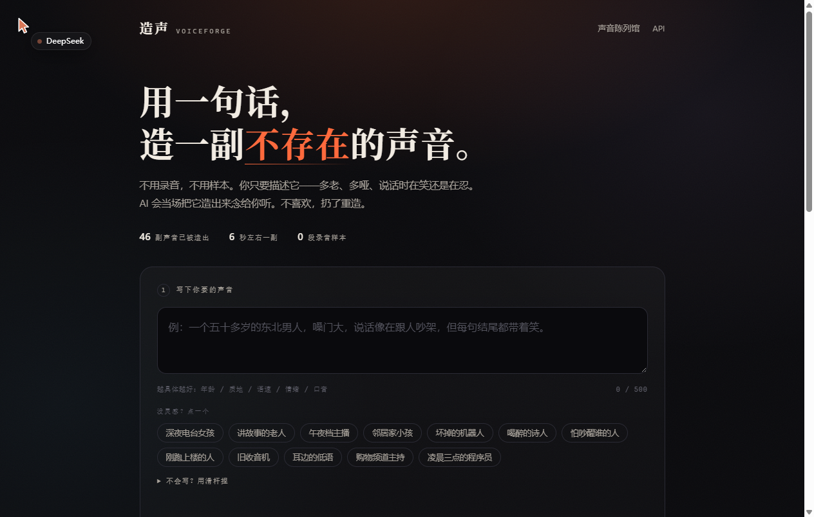
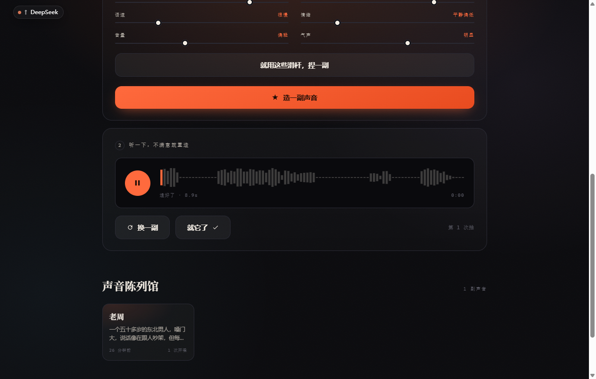
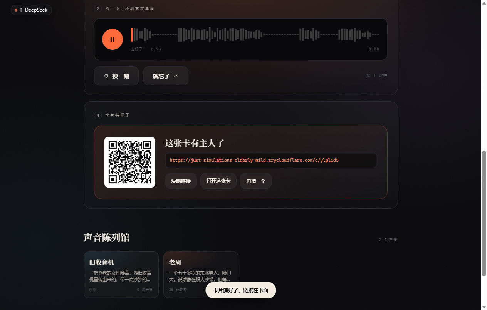
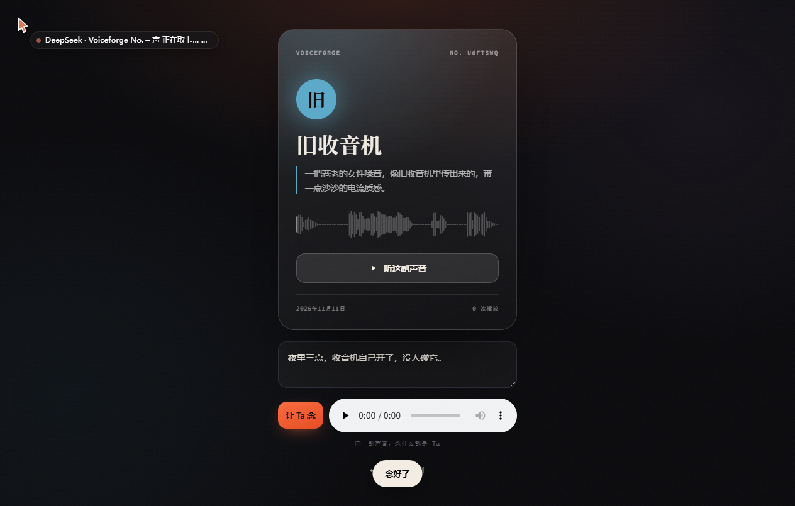

# 我用一句话，造出了 46 副不存在的声音——然后给它们做了身份证

> 全程没录一秒音。你说的每一个字，AI 都能给你一张嗓子。

---

## 先说结论

我做了个东西，叫**造声**。

你在框里写一句话——

> 一个五十多岁的东北男人，嗓门大，说话像在跟人吵架，但每句结尾都带着笑。

八秒钟后，这副嗓门就活了。它会开口说：「你好，我是刚刚被造出来的声音。你听，这就是我。」

跟你不满意？点「换一副」，它再给你一副**完全不同**的嗓子。同一句话，造三次，就是三个人。

满意了？起个名、挑个颜色，锁成一张**声音卡**。卡上有编号、有波形、有二维码。别人扫开这张卡，能让**这副声音**念**他自己**想听的话。



我把这张卡发给朋友，他输了一句「下辈子别他妈当程序员了」，然后用一个陌生老头的声音念出来。他说他起了一身鸡皮疙瘩。

---

## 为什么我想做这个

你有没有发现，所有「让 AI 说话」的产品，都卡在同一件事上：**声音从哪儿来**。

- 真人录音？得找人、得录、得授权。
- 声音克隆？你得先有那个人的 5 秒录音。
- 那我想要一个**根本不存在**的人呢？一个抽了四十年烟、七十岁、说话像在跟人赌气的老太太——上哪儿录去？

阿里云百炼有个能力叫**声音设计**（CosyVoice voice design），它把这件事反过来了：

**不给样本，给一句描述。** 它直接合成一副符合描述、此前世界上不存在的嗓子，还返回一个能长期复用的 `voice_id`。

接口是接口，不是产品。我把它做成了一个能玩、能传的东西。

---

## 三步，从一句话到一张卡

### 第一步：写描述（或者拉滑杆）

描述越**物理**越好。别写「好听的声音」，写：

> 年龄多大 / 声带粗不粗 / 语速快不快 / 说话时在笑还是在忍 / 有没有气声

首页给了 12 个灵感标签，点一下就填进去：深夜电台女孩、讲故事的老人、坏掉的机器人、喝醉的诗人、旧收音机、凌晨三点的程序员……



不想写字就拉滑杆：年龄、沙哑度、语速、情绪、音量、气声。**只有你动过的那几根**会被翻译成文字拼进描述——没动过的不算数，不然每副声音都会带上「三十岁、嗓音干净」这种默认值。

### 第二步：听，然后一直重抽

点「造一副声音」，等 6–9 秒。

这里有个我觉得最有意思的地方：**同一句描述，每次造出来都不一样。**

我特意测了三次：

| 第几次 | voice_id 尾段 | 音频 md5 | 耗时 |
|---|---|---|---|
| 1 | `tri0-596efce4` | `b8452c18…` | 8.9s |
| 2 | `tri1-c73663d7` | `b73e7685…` | 8.0s |
| 3 | `tri2-df547361` | `ea7c7c06…` | 8.1s |

三个完全不同的 `voice_id`，三段 md5 不同的音频。

这意味着什么？意味着它不是「从一百副预设嗓子里挑一副」，而是**每次都真的现造一副新的**。所以你抽卡的欲望会停不下来——就像开盲盒，但盲盒里装的是声带。

我连着造了 46 副，把满意的都留下来了——你现在点开首页底部的「声音陈列馆」就能一个个听。其中我最喜欢的是一个「像在雨里等了两小时、但还想再等一会儿」的声音。

### 第三步：锁成卡，让它属于你

起个名（老周 / 深夜三点 / 雨里的人）、选个颜色、铸成卡。

卡片长这样：



编号是随机生成的，波形是**真波形**——前端把音频拉下来，`AudioContext.decodeAudioData` 解出 PCM，按块取绝对峰值，画 96 根柱子。不是随机数，也不是贴图。

### 第四步：别人能拿它说话

这是我觉得这个项目跟「音色试听 demo」最不一样的地方。

点开 `/c/<卡片id>`，任何人都能输入一句话，让**这副声音**念出来。上限 300 字。



声音有了归属，也就有了社交属性。你造的不是一个「功能」，是一个「角色」。

---

## 技术上是怎么搭的

说出来有点不好意思：**没有前端框架，没有构建工具，没有 node_modules。**

```
FastAPI + 原生 HTML/CSS/JS + SQLite
```

三个 Python 文件（路由 / 百炼客户端 / 存储），一套静态页面。`pip install -r requirements.txt && python run.py` 就能跑。

为什么这么选？因为我想在三天里把**产品**做完，而不是把**脚手架**搭完。

几个我自己比较满意的取舍：

- **草稿和卡片分开存**。`/api/design` 只落草稿，点「就它了」才把音频复制一份成正式卡片。草稿可以随便清理，卡片永远不会失效。
- **波形是真的**。上面说了。
- **滑杆只认「动过的」**。用一个 `Set` 记录 touch 过的滑杆，拼描述时只拼这些。这个小细节让默认值不再污染结果。

---

## 踩的坑（这部分是真花钱买的）

### 坑 1：`url error, please check url！`

我一开始把语音合成打到了 `/api/v1/services/aigc/multimodal-generation/generation`。

返回 400，报 `InvalidParameter: url error, please check url！`。

我以为是网络问题，换了三个域名，加了三层重试，怀疑了代理、怀疑了防火墙、怀疑了人生。

最后在阿里云的错误码文档里看到这一条的官方解释：

> **原因一：模型名称与 API 端点不匹配。**

语音合成的端点是 `/api/v1/services/audio/tts/SpeechSynthesizer`。那个 multimodal 端点是给通义万相/千问 VL 这类多模态模型用的。

一行 URL，卡了我一晚上。

### 坑 2：文档里的新域名，我这儿解析不了

阿里云文档写的是 `https://{WorkspaceId}.cn-beijing.maas.aliyuncs.com/...`。

我这儿 `getaddrinfo failed`。

换成旧域名 `dashscope.aliyuncs.com`——通了，137ms。

### 坑 3：Windows 当前进程读不到刚设的环境变量

Key 是刚在「系统属性 → 环境变量」里设的，`os.environ` 里没有。

不是没设成功，是**当前这个进程的 env 快照是旧的**。程序里加了个兜底：进程里读不到，就去注册表读一次 `[Environment]::GetEnvironmentVariable('DASHSCOPE_API_KEY','User')`。

### 坑 4：波形画不出来，因为面板还没显示

`cv.clientWidth` 在元素 `display: none` 的时候是 `0`。于是 `cv.width = 0`，之后就算显示了，画布还是 0 像素宽，波形永远空白。

修法两行：`if (!W || !H) return;`，外加面板显示后主动重绘一次。

---

## 一些我没做到的事（说清楚）

- **我听不到音频。** 这是实话——我没有耳朵。我能从接口层面确认「三次三副嗓子」「同一个 id 稳定复现」，但**造出来像不像那句描述，得你自己听**。这是这个项目最大的验证盲区。
- **做不到秒回。** 造音色要 6–9 秒，念一句话要 1.5 秒。不是流式。
- **公网链接是临时的。** 我用 Cloudflare 免费隧道挂的，进程一停域名就换。要长期在线得自己配固定域名。
- **没有鉴权、没有限流。** 每次造声音都真实花钱，别直接挂公网不管。

---

## 最后

我一直觉得，AI 生成最迷人的地方不是「替你干活」，是**「造出原本不存在的东西」**。

文字可以凭空造，图片可以凭空造。声音一直不太行——它总得有个「原型」。

这次终于可以了。你可以造一副**只存在于你描述里**的嗓子，然后让它说任何话。

去造一副吧。造个你外婆的声音，造个你想象中二十年后的自己，造个你家猫如果会说话会是什么动静。

反正，它不用真的存在。

---

*项目地址与启动方式见 GitHub 仓库的 README；在线版见仓库首页的链接*
*造一副大概花 6–9 秒，按百炼的调用量计费*
